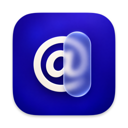
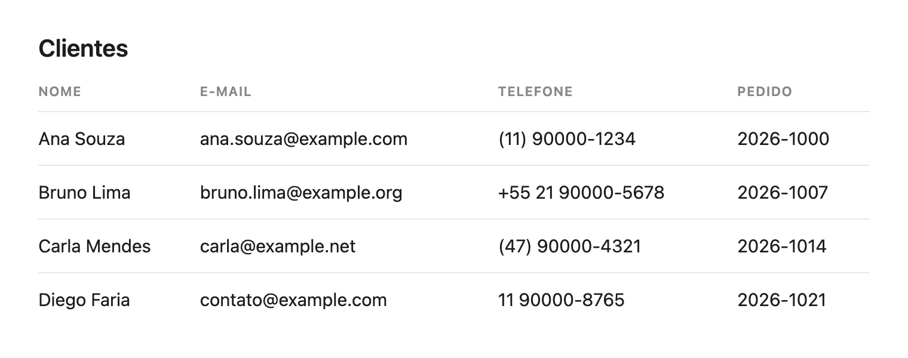
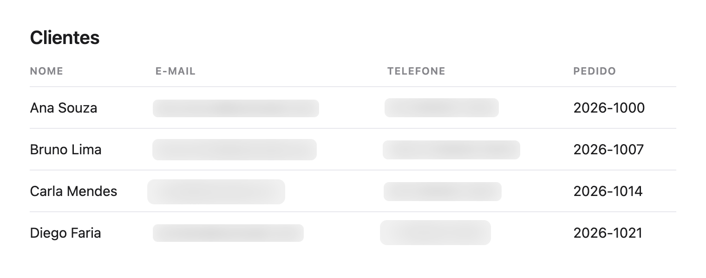

<p align="center">
  
</p>

# Fosco

App de barra de menus para macOS que borra e-mails e telefones nas capturas de tela, automaticamente, antes que elas sejam coladas ou compartilhadas.

Cada captura é lida no próprio Mac, com o reconhecimento de texto da Apple (Vision). Nada sai do computador.

| Antes | Depois |
| --- | --- |
|  |  |

## Instalação

1. Baixe o `Fosco-<versão>.dmg` da [versão mais recente](https://github.com/gabrielbuzziv/fosco/releases/latest).
2. Abra o arquivo e arraste o Fosco para a pasta Aplicativos.
3. Abra o Fosco. O macOS bloqueia a primeira abertura, porque o app ainda não é notarizado pela Apple: em Ajustes do Sistema › Privacidade e Segurança, role até o aviso sobre o Fosco e clique em **Abrir Mesmo Assim**.

Requer macOS 15.4 ou posterior, em Macs com chip Apple ou Intel.

Depois de aberto, o Fosco fica na barra de menus, no ícone de olho riscado, e passa a abrir sozinho quando você inicia a sessão.

## O que ele cobre

| Para onde a captura vai | O que o Fosco faz |
| --- | --- |
| Copiada para a área de transferência (Shottr, <kbd>⌃⇧⌘4</kbd>, qualquer app que copie só a imagem) | Tira a captura da área de transferência enquanto a lê e devolve a cópia borrada, ou a original intacta se não houver nada a esconder |
| Salva em `~/Pictures/Screenshots` | Borra cada imagem nova, no próprio arquivo |
| Salva na pasta de capturas do macOS (a Mesa, por padrão) | Borra os arquivos novos que o macOS marcou como captura de tela |

O que o Fosco borra é a cópia que você cola e o arquivo salvo. Uma notificação avisa cada vez que algo é borrado.

### Shottr

Quando o Shottr abre a captura no editor, o Fosco pede a ele para mostrar a cópia borrada no lugar da original, cerca de um segundo depois. A partir daí, copiar, salvar, fixar ou arrastar a imagem do Shottr leva a versão borrada, e **Restaurar Original** devolve a original também ao editor.

A miniatura de pré-visualização do Shottr não pode ser trocada: ela continua com a original até ser usada ou fechada, e a notificação do Fosco avisa quando é o caso. Para ter a troca, deixe a captura de área abrir o editor em vez da pré-visualização, nos ajustes do Shottr.

Outros apps de captura continuam mostrando a original na janela deles, como a miniatura flutuante do macOS.

A leitura leva cerca de 0,3 s em uma captura de área e de 1 a 1,5 s em uma tela inteira de 1440p. Nesse intervalo a área de transferência fica vazia, e o ícone da barra de menus mostra `…` quando a espera é longa o bastante para ser notada.

## O que ele não cobre

- Capturas arrastadas da miniatura flutuante do macOS, da miniatura de pré-visualização do Shottr, ou do editor do Shottr no segundo em que a captura ainda está sendo lida. Elas não passam pela área de transferência nem por uma pasta monitorada.
- Imagens copiadas junto com outros dados (um slide, uma camada de design, uma imagem de página da web). São conteúdo do próprio app de origem e ficam como estão.
- Outros dados sensíveis. O Fosco procura e-mails e telefones (formato brasileiro, norte-americano ou internacional com `+`); CPF, CNPJ, cartões e senhas não são detectados.
- O reconhecimento de texto pode falhar: fontes incomuns ou texto muito pequeno podem passar. Um número quebrado em duas linhas mantém os dígitos da segunda.
- Um gerenciador de área de transferência pode registrar a original nos milissegundos antes de o Fosco tirá-la de lá.

## Menu

- **Borrar E-mails e Telefones**: pausa e retoma.
- **Restaurar Original**: desfaz o último borrão, na área de transferência ou no arquivo. Essa captura não volta a ser borrada se for copiada de novo.
- **Abrir ao Iniciar Sessão**: ativado por padrão.

## Permissões

O macOS pode pedir:

- **Notificações**, para avisar quando uma captura é borrada.
- **Pasta Mesa**, na primeira vez que uma captura for salva lá.
- **Colar de Outros Apps** (em Privacidade e Segurança), nos sistemas em que o macOS restringe a leitura da área de transferência. O menu mostra o atalho quando for preciso.

## Desinstalação

Desmarque **Abrir ao Iniciar Sessão**, encerre o Fosco, apague-o da pasta Aplicativos e rode `defaults delete com.gabrielbuzzi.fosco`.

## Ajustes

Monitorar outra pasta que só guarde capturas de tela:

```sh
defaults write com.gabrielbuzzi.fosco screenshotFolders -array-add "/caminho/da/pasta"
```

Borrar um único arquivo pela linha de comando:

```sh
/Applications/Fosco.app/Contents/MacOS/Fosco redact captura.png [saída.png]
```

Diagnóstico (só contagens, nunca o conteúdo):

```sh
log show --last 10m --predicate 'subsystem == "com.gabrielbuzzi.fosco"'
```

## Desenvolvimento

```sh
swift test                                        # testes unitários e de ponta a ponta, cerca de 20 s
FOSCO_BENCH=1 swift test --filter ScanBenchmark   # precisão e tempo dos layouts de leitura
./scripts/install.sh                              # compila, instala em /Applications e abre
./scripts/release.sh                              # gera build/Fosco-<versão>.dmg, universal
./scripts/make-fixtures.sh                        # renderiza de novo as telas de teste (precisa do Chrome for Testing)
./scripts/make-example.sh                         # renderiza de novo o antes e depois deste README
swift scripts/make-icon.swift                     # gera Support/Fosco.icns a partir de Support/icon-art.png
```

O macOS vincula as permissões concedidas à assinatura do app. Para mantê-las entre uma compilação e outra, coloque uma identidade de assinatura (nome ou hash de `security find-identity -v -p codesigning`) em `.signing-identity`, ou passe `SIGN_IDENTITY`. Sem isso, o app é assinado ad hoc.

O `release.sh` assina com o certificado Developer ID Application que estiver nas chaves e notariza o app. Sem o certificado, assina ad hoc. A versão vem de `CFBundleShortVersionString`, em `Support/Info.plist`.

`FoscoCore` reúne tudo o que é testável: a detecção (`TextDetector`), a leitura em blocos (`TextScanner`, `TileLayout`), o borrão (`RegionBlur`) e os dois vigias (`ClipboardGuard`, `FolderGuard`). `Fosco` é a casca fina de AppKit em volta.

Os testes nunca tocam a área de transferência real nem as pastas de capturas: usam uma área de transferência privada e um diretório temporário.

## Licença

[MIT](LICENSE)
